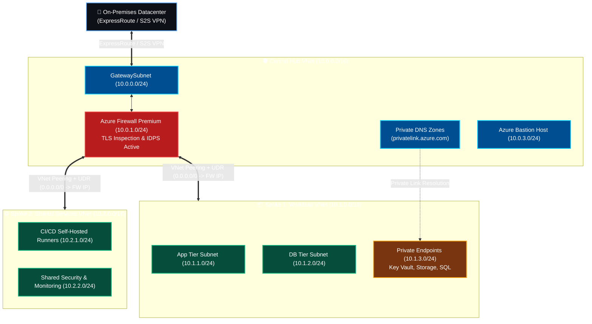

<div align="center">


<p align="center">
  
  
  
  
</p>

</div>

---

## 🧭 Overview

This repository provides an **enterprise-grade, production-hardened Terraform module** implementing the official **Microsoft Cloud Adoption Framework (CAF)** Azure Landing Zone with a **Zero-Trust Hub-and-Spoke networking topology**.

Designed to support **100+ mission-critical workloads** with centralized traffic inspection, granular microsegmentation, private PaaS endpoints, unified governance, and FinOps-optimized logging.

```
                           [ Microsoft Entra ID Tenant ]
                                         |
                             [ Tenant Root Group ]
                                         |
        +--------------------------------+--------------------------------+
        |                                |                                |
[ Platform Management Group ]   [ Landing Zones (Workloads) ]    [ Sandbox / Decomm ]
   |-- Identity (AD/DNS)           |-- Corp (Internal Only)         |-- Sandbox MG
   |-- Management (Logs/Mon)       |-- Online (Public/DMZ)          `-- Decommissioned
   `-- Connectivity (Hub/Firewall) |-- Dev Subscriptions
                                   |-- UAT Subscriptions
                                   `-- Prod Subscriptions
```

---

## 🏛️ Architecture & Network Flow



---

## ⚡ Core Features

- **Management Group Hierarchy:** Fully CAF-compliant tree separating Platform (Identity, Management, Connectivity) from Landing Zones (Corp, Online).
- **Central Inspection:** Azure Firewall Premium with Threat Intelligence, Network Rules, Application Rules, and IDPS in Deny mode.
- **Forced Tunneling (UDR):** Spoke subnets route all `0.0.0.0/0` (Internet) and inter-spoke traffic through the Azure Firewall virtual appliance.
- **Private Link Architecture:** Pre-configured Private DNS Zones (`privatelink.vaultcore.azure.net`, `privatelink.blob.core.windows.net`, `privatelink.database.windows.net`) linked to Hub and Spokes.
- **FinOps Log Tuning:** Central Log Analytics Workspace with customized Azure Monitor Data Collection Rules (DCR) to filter noisy diagnostic telemetry.
- **Policy as Code:** Azure Policy assignments enforcing mandatory Environment tags and restricting deployments strictly to compliant Azure regions.

---

## 🚀 Quickstart

### Prerequisites
- [Terraform](https://www.terraform.io/) `>= 1.5.0`
- [Azure CLI](https://docs.microsoft.com/en-us/cli/azure/install-azure-cli) logged in with `Owner` or `Contributor` rights at the tenant/subscription level:
  ```bash
  az login
  az account set --subscription "<YOUR_SUBSCRIPTION_ID>"
  ```

### Deployment Steps
```bash
# 1. Clone the repository
git clone https://github.com/swapnilagarwal30/azure-enterprise-landingzone-tf.git
cd azure-enterprise-landingzone-tf

# 2. Configure variables
cp terraform.tfvars.example terraform.tfvars
# Edit terraform.tfvars with your enterprise naming conventions and IP spaces

# 3. Initialize Terraform
terraform init

# 4. Review Speculative Execution Plan
terraform plan -out=tfplan

# 5. Apply Infrastructure
terraform apply tfplan
```

---

## 📊 Modules Structure

```
.
├── main.tf                  # Root module coordinating all components
├── variables.tf             # Input variables with strict validation rules
├── outputs.tf               # Exported IDs, endpoints, and IPs
├── versions.tf              # Provider and Terraform constraints
├── terraform.tfvars.example # Example variable parameters
└── modules/
    ├── management-groups/   # Tenant & CAF management group tree
    ├── hub-network/         # Hub VNet, subnets, Bastion host
    ├── firewall/            # Azure Firewall Premium, rules & diagnostics
    ├── spoke-network/       # Reusable Spoke VNet with UDR & NSGs
    ├── private-dns-endpoints/ # Private DNS Zones & VNet link bindings
    ├── governance-policy/   # Azure Policy definitions & assignments
    └── monitoring/          # Log Analytics Workspace & DCR rules
```

---

## 🛡️ Security & Compliance Standards

| Layer | Control Implemented |
| :--- | :--- |
| **Perimeter** | Azure Firewall Premium with TLS inspection and active IDPS. |
| **Routing** | Zero direct Internet egress; UDR forced routing via Firewall Next Hop. |
| **PaaS** | Public network access disabled on PaaS; Private Endpoints enforced. |
| **Governance** | Built-in Azure Policy auditing non-compliant tags and unapproved regions. |

---

## 👤 Author

**Swapnil Agarwal**  
*Senior DevSecOps Engineer & Azure Cloud Architect*  
- **Email:** [swapnilagarwal94@gmail.com](mailto:swapnilagarwal94@gmail.com)  
- **GitHub:** [@swapnilagarwal30](https://github.com/swapnilagarwal30)  
- **LinkedIn:** [Swapnil Agarwal](https://www.linkedin.com/in/swapnilagarwal30/)
